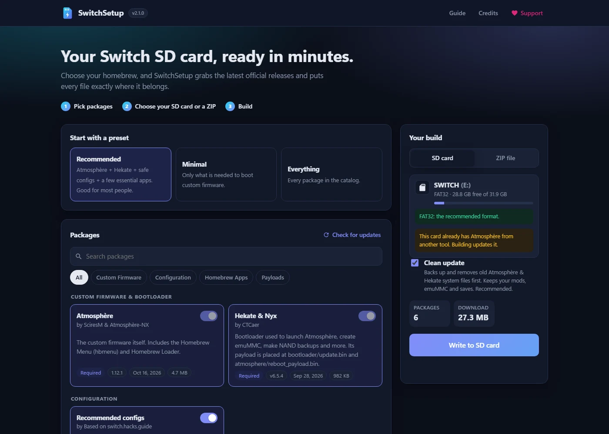

# SwitchSetup

**Website: [switchsetup.app](https://switchsetup.app)** · [Download for Windows](https://github.com/Osatks/SwitchSetup/releases/latest/download/SwitchSetup.exe)



Set up your Switch SD card in minutes. Pick your homebrew and SwitchSetup downloads the latest official
releases and puts every file exactly where it belongs, either straight onto your SD card or into a ZIP.

**Based on [Homebrew SD Setup](https://github.com/noahc3/SDSetup) by noahc3** (2018–2024). All credit for the
original idea and project goes to noahc3. Released under the same MPL-2.0 license.

Not affiliated with, endorsed by or sponsored by Nintendo. SwitchSetup does not provide or support piracy.

☕ Support the project: [ko-fi.com/osatks](https://ko-fi.com/osatks)

## Features

- **Write straight to the SD card**, or build a ZIP. The card is detected automatically when you plug it in.
- **Always up to date.** Every package comes directly from its official GitHub release. No re-hosted files.
- **Knows what's on your card.** Cards built with SwitchSetup show "On card" and "Update 1.10.0 → 1.12.1" badges, plus a one-click **Update my card** preset.
- **Safe clean updates.** Old Atmosphère and Hekate system files are backed up to `Documents\SwitchSetup Backups` and removed, while your mods (`atmosphere/contents`), `bootloader/ini`, payloads, emuMMC, saves and Nintendo folder are kept.
- **Download first, write second.** Nothing touches the card until every file has downloaded, so a dropped connection can't leave it half-written.
- **Safety checks.** Only removable drives are listed, so it can never write to C:. It warns about exFAT and blocks NTFS cards.
- **Eject button** when it's done.
- Presets (Recommended / Minimal / Everything), search, category filters, and download sizes.
- Recommended configs from switch.hacks.guide: `hekate_ipl.ini`, DNS-MITM host files that block Nintendo servers, and `exosphere.ini`.
- Save or load your selection as a file. Light and dark themes follow Windows.

## Use it

1. Run `SwitchSetup.exe`. Your browser opens at `http://127.0.0.1:5175`.
2. Insert your SD card, or switch to **ZIP file**.
3. Pick a preset or individual packages, then click **Write to SD card** / **Build ZIP**.

Options: `--port 8080`, `--no-browser`. If you hit GitHub's limit of 60 checks per hour, set a `GITHUB_TOKEN` environment variable.

## Add or fix a package

Put a copy of [`app/catalog.json`](app/catalog.json) next to `SwitchSetup.exe` and edit it. It overrides the built-in catalog, no rebuild needed.

```json
{
  "id": "myapp",
  "name": "My App",
  "category": "homebrew",
  "authors": "someone",
  "description": "What it does",
  "repo": "owner/repo",
  "assets": [ { "match": "^MyApp\\.nro$", "action": "copy", "to": [ "switch/MyApp.nro" ] } ]
}
```

- `"action": "extract"` unzips the asset into the SD root (`exclude` is a regex of entries to skip)
- `"action": "copy"` copies the asset to every path in `to`
- `files` writes generated text files (see the `configs` package)
- `dependencies` and `required` control auto-selection
- The `support` section sets the donation links shown in the app

## Build from source

```bash
dotnet publish app/SwitchSetup.csproj -c Release -r win-x64 -o publish
```

For development, set `SWITCHSETUP_TEST_CARD=C:\some\folder` to show that folder as a fake SD card, so you can test without a real card.

## Repository layout

| Folder | What it is |
|---|---|
| `app/` | The Windows app (.NET 8). The UI is in `app/wwwroot`, the package list in `app/catalog.json` |
| `web/` | The switchsetup.app website, static files served by Cloudflare Workers (config in `wrangler.jsonc`) |
| `.github/workflows/` | `build.yml` checks every push. `release.yml` builds `SwitchSetup.exe` when you push a `v*` tag |

## Releasing a new version

```bash
git tag v2.1.0
git push origin v2.1.0
```

GitHub Actions builds `SwitchSetup.exe` and attaches it to a new release. The website's download button always serves the latest one.

## Credits

- **noahc3**: original Homebrew SD Setup, the concept, and the code this is based on
- Each package's authors, listed in the app under Credits
- [switch.hacks.guide](https://switch.hacks.guide) for the recommended configuration
